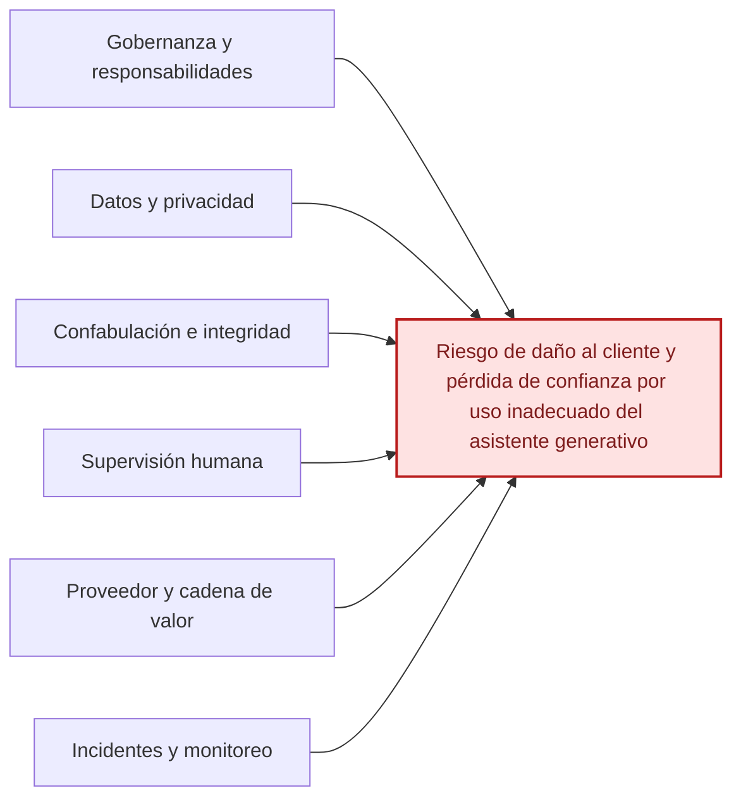

# Ishikawa — Caso de asistente generativo para atención a clientes

[Volver al índice](./NIST_Indice.md) · [Consultar el caso práctico](./NIST_AI_600_1_Caso_Practico.md)

**Efecto principal:** Riesgo de daño al cliente y pérdida de confianza por uso inadecuado del asistente generativo.

## Causas principales

### 1. Gobernanza y responsabilidades

- Usos permitidos y prohibidos poco definidos.
- Responsables del sistema e incidentes no claros.
- Tolerancia al riesgo no establecida.

### 2. Datos y privacidad

- Acceso amplio a registros de clientes.
- Posible exposición de datos de terceros.
- Controles insuficientes sobre información sensible.

### 3. Confabulación e integridad

- Respuestas convincentes pero incorrectas.
- Fuentes y datos no siempre verificables.
- Trazabilidad limitada del contenido generado.

### 4. Supervisión humana

- Empleados copian respuestas sin verificarlas.
- Automation bias o confianza excesiva.
- Criterios de revisión humana insuficientes.

### 5. Proveedor y cadena de valor

- Poca transparencia sobre datos y modelo externo.
- Cambios del proveedor no suficientemente documentados.
- Obligaciones contractuales débiles o incompletas.

### 6. Incidentes y monitoreo

- No existe un registro uniforme de errores.
- Falta de criterios para escalar o comunicar incidentes.
- Monitoreo post-despliegue insuficiente.

## Diagrama editable en Markdown (Mermaid)

La siguiente vista representa las mismas familias de causas en un esquema de relaciones. **La figura anterior conserva la disposición original de Ishikawa**; esta versión se puede modificar directamente en GitHub.

---

*Fuente: elaboración propia con base en el marco NIST correspondiente y en el caso académico, cuando aplica. Las categorías representan una síntesis para estudio, no una lista normativa de cumplimiento.*
