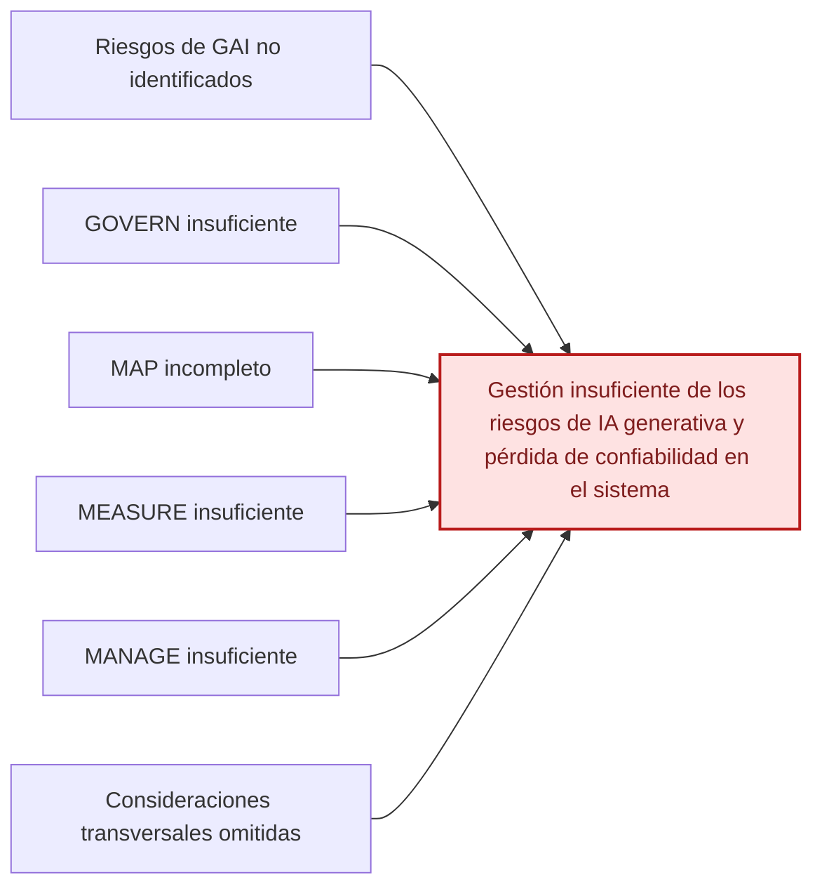

# Ishikawa del NIST AI 600-1 — GAI Profile

[Volver al índice](./NIST_Indice.md) · [Consultar el escrito](./NIST_AI_600_1_Escrito.md)

**Efecto principal:** Gestión insuficiente de los riesgos de IA generativa y pérdida de confiabilidad en el sistema.

## Causas principales

### 1. Riesgos de GAI no identificados

- Confabulación, privacidad e integridad de la información.
- Sesgo perjudicial y homogeneización.
- Seguridad, propiedad intelectual y riesgos de terceros.

### 2. GOVERN insuficiente

- Roles y responsabilidades poco claros.
- Requisitos legales y políticas de uso no integrados.
- Tolerancia al riesgo y controles de terceros débiles.

### 3. MAP incompleto

- Propósito, contexto y usuarios mal definidos.
- Limitaciones y usos indebidos no anticipados.
- Impactos sobre personas, grupos y entorno poco caracterizados.

### 4. MEASURE insuficiente

- Pruebas previas al despliegue limitadas.
- Exceso de confianza en benchmarks.
- Pruebas reales, red teaming y retroalimentación insuficientes.

### 5. MANAGE insuficiente

- Riesgos prioritarios sin tratamiento documentado.
- Riesgo residual sin monitoreo continuo.
- Criterios de corrección o desactivación poco claros.

### 6. Consideraciones transversales omitidas

- Content provenance poco desarrollado.
- Incident disclosure y aprendizaje insuficientes.
- Supervisión humana y participación de actores limitadas.

## Diagrama editable en Markdown (Mermaid)

La siguiente vista representa las mismas familias de causas en un esquema de relaciones. **La figura anterior conserva la disposición original de Ishikawa**; esta versión se puede modificar directamente en GitHub.

---

*Fuente: elaboración propia con base en el marco NIST correspondiente y en el caso académico, cuando aplica. Las categorías representan una síntesis para estudio, no una lista normativa de cumplimiento.*
