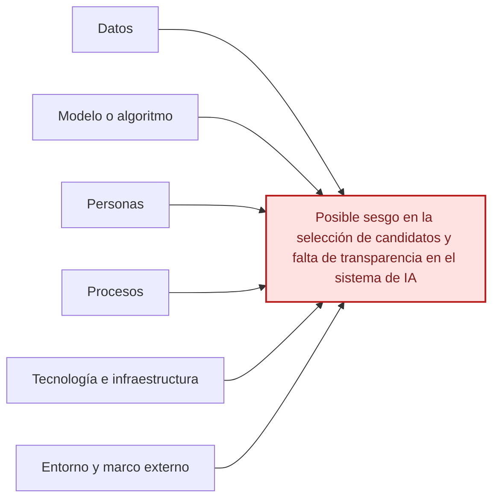

# Ishikawa — Caso de IA para selección de personal

[Volver al índice](./NIST_Indice.md) · [Consultar el caso práctico](./NIST_AI_RMF_1.0_Caso_Practico.md)

**Efecto principal:** Posible sesgo en la selección de candidatos y falta de transparencia en el sistema de IA.

## Causas principales

### 1. Datos

- Datos históricos con sesgos.
- Representatividad insuficiente de grupos.
- Procedencia o calidad poco conocidas.

### 2. Modelo o algoritmo

- Criterios de decisión poco transparentes.
- Puntuaciones sin suficiente explicabilidad.
- Modelo preentrenado insuficientemente evaluado.

### 3. Personas

- Reclutadores sin capacitación suficiente.
- Confianza excesiva en puntuaciones.
- Supervisión humana insuficiente.

### 4. Procesos

- Pruebas previas y monitoreo insuficientes.
- Falta de métricas de equidad.
- Ausencia de apelación para candidatos.

### 5. Tecnología e infraestructura

- Dependencia de proveedor externo.
- Dificultad para controlar cambios y auditar el modelo.
- Integración con otros sistemas sin validaciones.

### 6. Entorno y marco externo

- Requisitos legales antidiscriminación y privacidad.
- Expectativas de equidad en contratación.
- Limitaciones contractuales del proveedor.

## Diagrama editable en Markdown (Mermaid)

La siguiente vista representa las mismas familias de causas en un esquema de relaciones. **La figura anterior conserva la disposición original de Ishikawa**; esta versión se puede modificar directamente en GitHub.

---

*Fuente: elaboración propia con base en el marco NIST correspondiente y en el caso académico, cuando aplica. Las categorías representan una síntesis para estudio, no una lista normativa de cumplimiento.*
