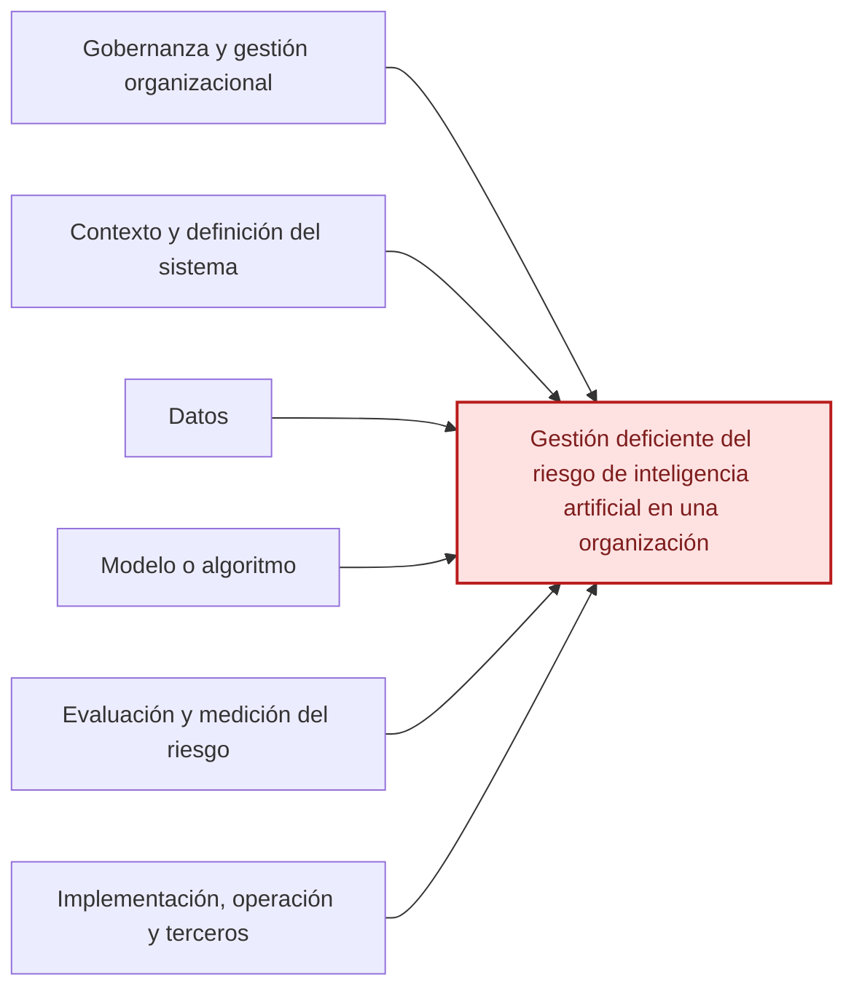

# Ishikawa del NIST AI RMF 1.0

[Volver al índice](./NIST_Indice.md) · [Consultar el escrito](./NIST_AI_RMF_1.0_Escrito.md)

**Efecto principal:** Gestión deficiente del riesgo de inteligencia artificial en una organización.

## Causas principales

### 1. Gobernanza y gestión organizacional

- Políticas o responsabilidades insuficientes.
- Escasa participación de la dirección.
- Capacitación y rendición de cuentas limitadas.

### 2. Contexto y definición del sistema

- Propósito, alcance y limitaciones mal definidos.
- Personas afectadas y beneficios no evaluados.
- Contexto legal, social y ético poco considerado.

### 3. Datos

- Datos de baja calidad o poco representativos.
- Sesgos históricos o sistémicos.
- Origen, cambios y protección de datos poco documentados.

### 4. Modelo o algoritmo

- Modelo inadecuado para el propósito.
- Falta de validación, explicabilidad e interpretabilidad.
- Drift o componentes preentrenados no evaluados.

### 5. Evaluación y medición del riesgo

- Métricas y pruebas TEVV insuficientes.
- Impactos en personas y sociedad no examinados.
- Ausencia de seguimiento o revisión independiente.

### 6. Implementación, operación y terceros

- Proveedores externos sin evaluación.
- Falta de supervisión humana y seguridad.
- Planes de incidentes, cambios y desactivación insuficientes.

## Diagrama editable en Markdown (Mermaid)

La siguiente vista representa las mismas familias de causas en un esquema de relaciones. **La figura anterior conserva la disposición original de Ishikawa**; esta versión se puede modificar directamente en GitHub.

---

*Fuente: elaboración propia con base en el marco NIST correspondiente y en el caso académico, cuando aplica. Las categorías representan una síntesis para estudio, no una lista normativa de cumplimiento.*
