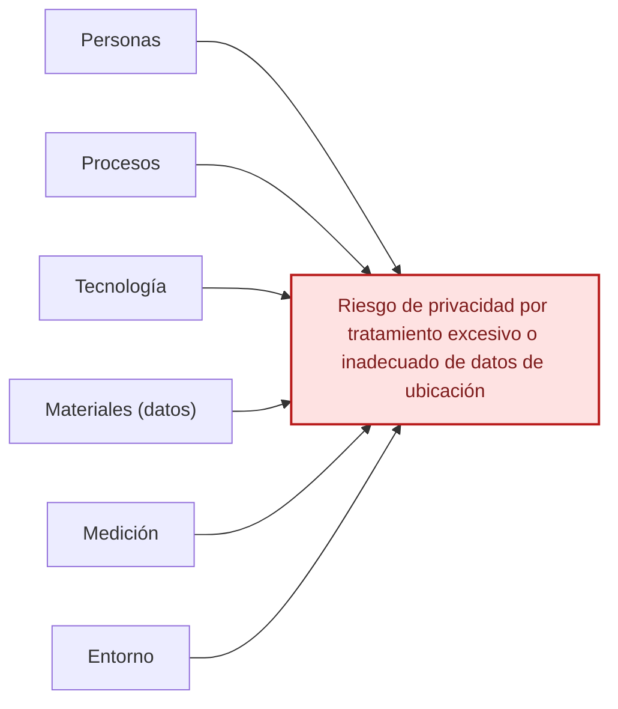

# Ishikawa — Caso de privacidad en entregas a domicilio

[Volver al índice](./NIST_Indice.md) · [Consultar el caso práctico](./NIST_Privacy_Framework_Caso_Practico.md)

**Efecto principal:** Riesgo de privacidad por tratamiento excesivo o inadecuado de datos de ubicación.

## Causas principales

### 1. Personas

- Falta de capacitación en privacidad.
- Accesos internos mayores a los necesarios.
- Desconocimiento de políticas de tratamiento.

### 2. Procesos

- Recopilación aun sin entrega activa.
- Conservación por más tiempo del necesario.
- Revisión insuficiente de finalidades y proveedores.

### 3. Tecnología

- Aplicación mantiene GPS activo.
- Mecanismos insuficientes de minimización.
- Controles de acceso y monitoreo limitados.

### 4. Materiales (datos)

- Ubicación recopilada más allá de lo necesario.
- Datos detallados vinculables a una persona.
- Información compartida con proveedores externos.

### 5. Medición

- Falta de métricas sobre necesidad de datos.
- Evaluación de privacidad insuficiente.
- Monitoreo limitado del acceso y uso de datos.

### 6. Entorno

- Uso de proveedores externos de analítica.
- Requisitos contractuales insuficientes.
- Expectativas crecientes de privacidad y transparencia.

## Diagrama editable en Markdown (Mermaid)

La siguiente vista representa las mismas familias de causas en un esquema de relaciones. **La figura anterior conserva la disposición original de Ishikawa**; esta versión se puede modificar directamente en GitHub.

---

*Fuente: elaboración propia con base en el marco NIST correspondiente y en el caso académico, cuando aplica. Las categorías representan una síntesis para estudio, no una lista normativa de cumplimiento.*
