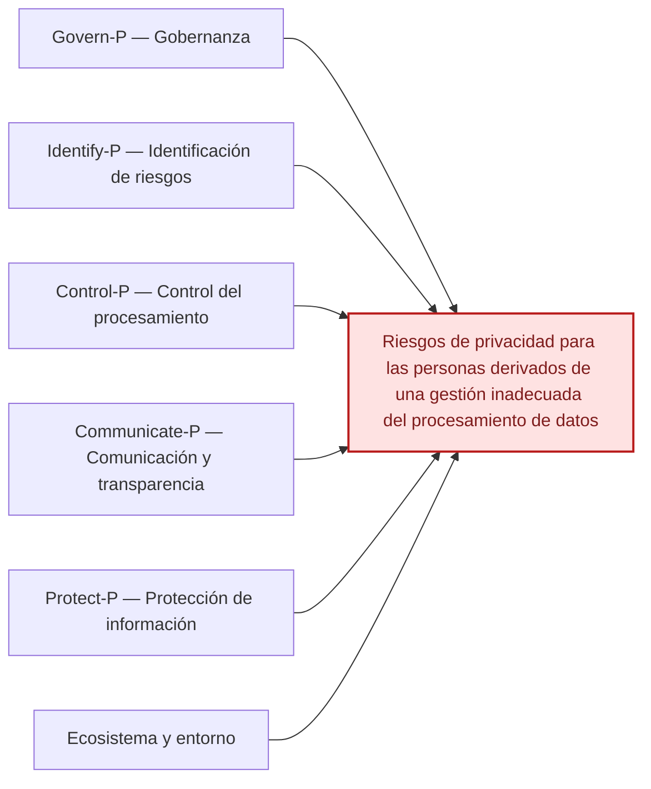

# Ishikawa del NIST Privacy Framework 1.0

[Volver al índice](./NIST_Indice.md) · [Consultar el escrito](./NIST_Privacy_Framework_Escrito.md)

**Efecto principal:** Riesgos de privacidad para las personas derivados de una gestión inadecuada del procesamiento de datos.

## Causas principales

### 1. Govern-P — Gobernanza

- Políticas y lineamientos de privacidad insuficientes.
- Responsabilidades y tolerancia al riesgo no definidas.
- Requisitos legales y regulatorios poco considerados.

### 2. Identify-P — Identificación de riesgos

- Inventario y mapeo de datos incompletos.
- Finalidades del tratamiento no documentadas.
- Evaluación insuficiente de riesgos y proveedores.

### 3. Control-P — Control del procesamiento

- Recopilación mayor a la necesaria.
- Conservación de datos sin criterios claros.
- Mecanismos limitados para gestionar los datos personales.

### 4. Communicate-P — Comunicación y transparencia

- Información de privacidad poco clara.
- Falta de visibilidad sobre uso y compartición de datos.
- Canales limitados para solicitudes y retroalimentación.

### 5. Protect-P — Protección de información

- Accesos internos excesivos.
- Autenticación y protección de datos insuficientes.
- Monitoreo y gestión de vulnerabilidades limitados.

### 6. Ecosistema y entorno

- Evaluación limitada de proveedores.
- Requisitos contractuales poco claros.
- Presiones para nuevos usos de datos sin evaluación previa.

## Diagrama editable en Markdown (Mermaid)

La siguiente vista representa las mismas familias de causas en un esquema de relaciones. **La figura anterior conserva la disposición original de Ishikawa**; esta versión se puede modificar directamente en GitHub.

---

*Fuente: elaboración propia con base en el marco NIST correspondiente y en el caso académico, cuando aplica. Las categorías representan una síntesis para estudio, no una lista normativa de cumplimiento.*
